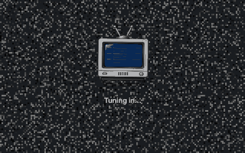
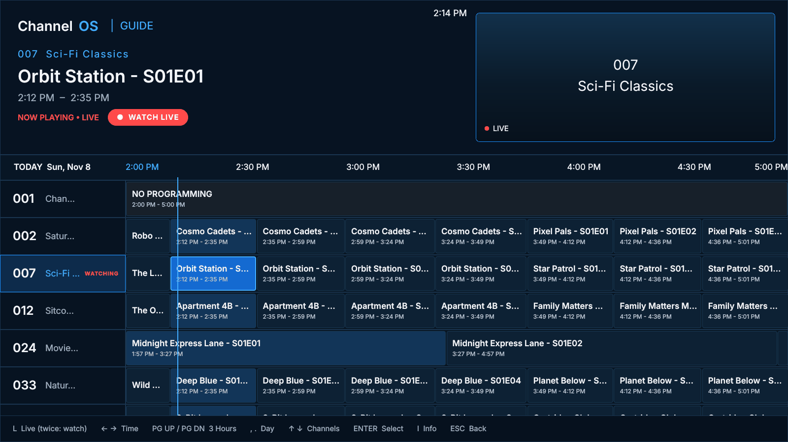
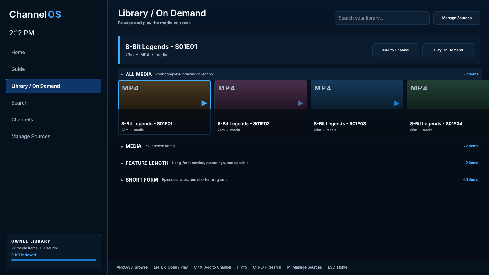
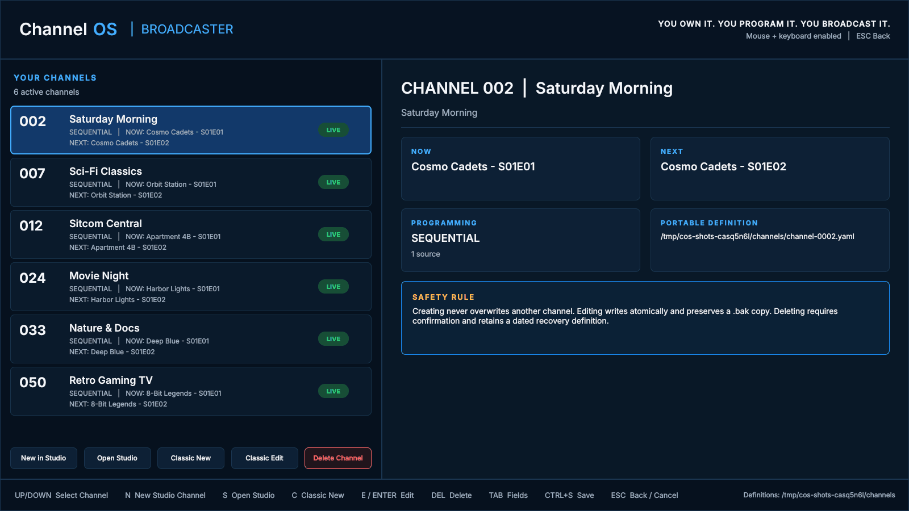
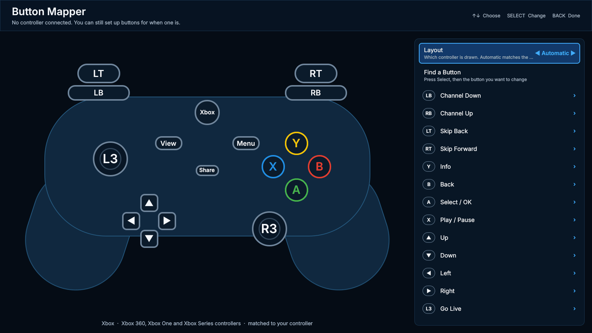
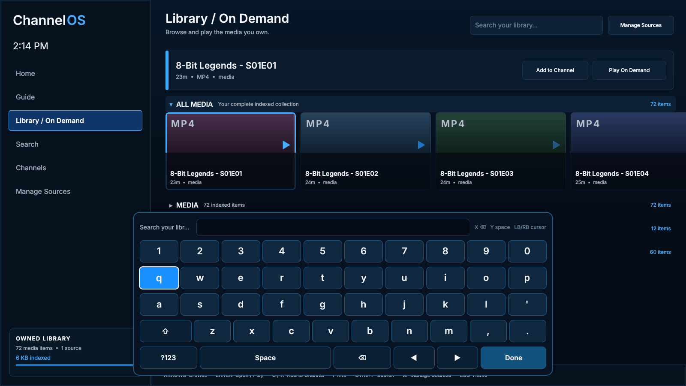
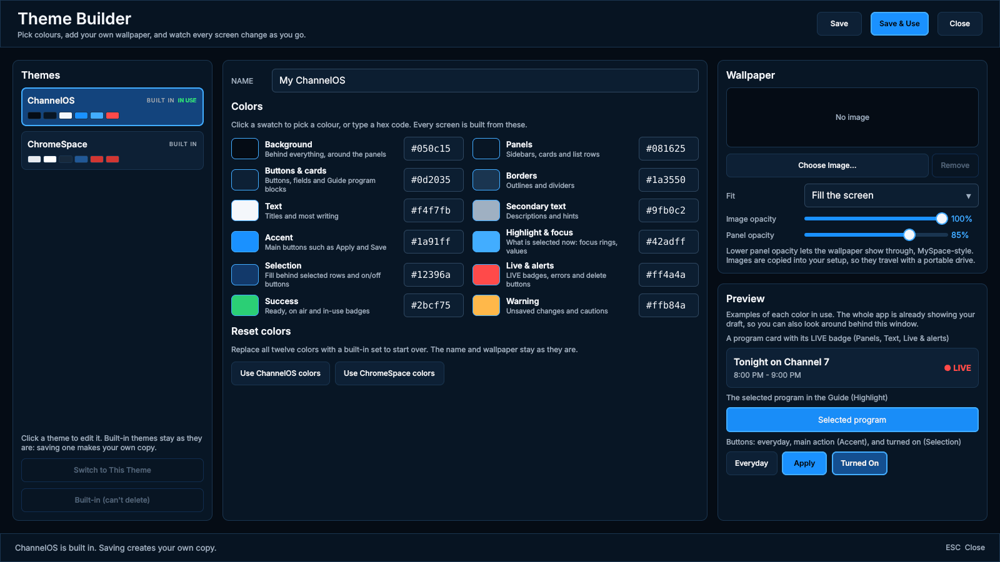
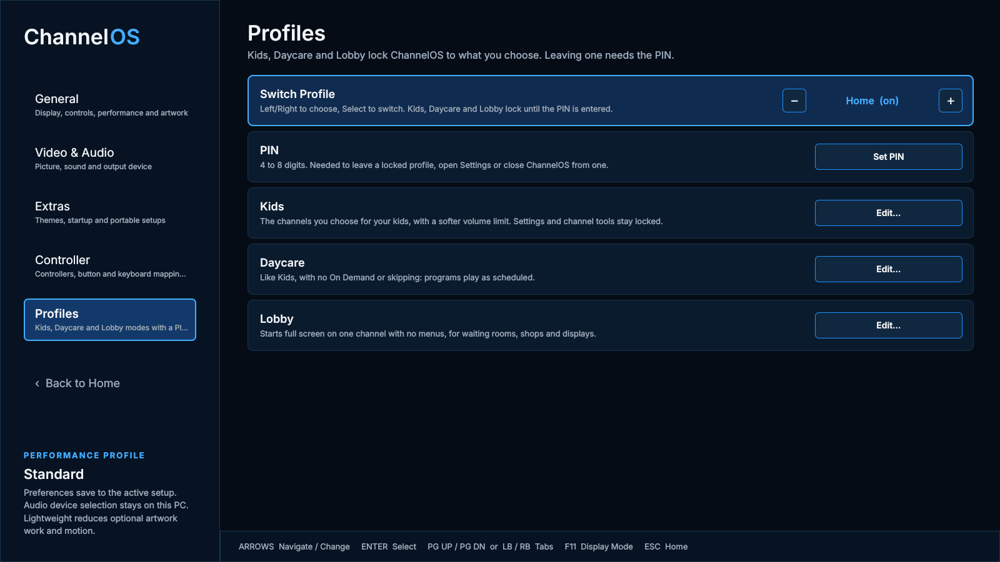
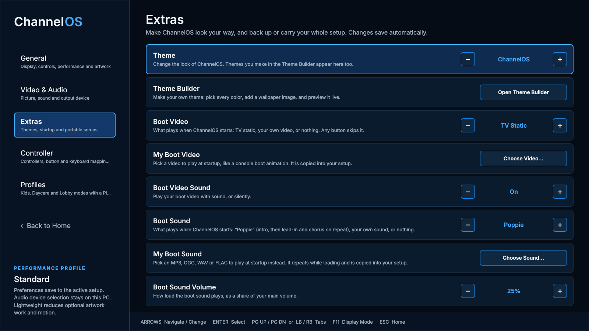

# ChannelOS V2 Beta 1 (2.0.0-beta.1)

  

<h3 align="center">Your shows. Your channels. Your TV network.</h3>

ChannelOS turns the shows and movies you already own into live, cable-style TV:
numbered channels that keep airing whether you're watching or not, a real TV Guide,
and a couch-first interface built for a controller or remote. 
It runs <b>on your own Windows PC</b>. No account, no subscription, no internet needed.

---

## ⬇️ Get it in 3 steps

| | |
|---|---|
| **1. Download** | Grab **`ChannelOS-2.0.0-beta.1-windows-x64.zip`** from **Assets** at the bottom of this page. |
| **2. Unzip** | Extract it anywhere: Desktop, Documents, a USB drive. Nothing is installed, and nothing is changed outside that folder. |
| **3. Run** | Open the `ChannelOS` folder and double-click **`ChannelOS.exe`**. |

> **Windows says "Windows protected your PC"?** That's because this beta isn't code-signed yet (signing comes with the Store version). Click **More info → Run anyway**.
>
> **First time?** Go to **Library → Manage Sources** and add a folder of your videos, then open **Channels** and make your first channel. ChannelOS starts airing it right away.

**Requirements:** Windows 10 or 11 (64-bit). A controller is optional: keyboard and mouse work everywhere.

---

## 📺 What ChannelOS does

### Live channels that never stop
Every channel runs on its own **Broadcast Clock**. Leave Channel 7 at 2:12 and come back at 3:00, and it has moved on, just like real TV. Pause, rewind or skip ahead when you want to, then press **Go Live** to jump back to what's airing now.

### A real TV Guide

See what's on now and next on every channel, scroll hours ahead or by the day, and press **LIVE** to jump to the current time. Press it again to start watching.

### Your library, On Demand

Everything you add is indexed into one Library. Browse it, search it, play anything On Demand, or send it straight to a channel with **Add to Channel**. Going back to TV picks the channels up exactly where they are.

### Build channels your way

- **Quick channels:** point a channel at a folder and choose **Sequential** (episodes in order) or **Shuffle**.
- **Channel Studio:** program a channel on a real calendar (day, week or month), drag shows onto a 24-hour timeline, **Auto Fill** a range, copy and repeat weeks, and set show-specific filler.
- **Broadcast Planner:** lay out a whole season of programming with time windows and rules, preview it, then apply it.
- **Ad breaks (optional):** add your own bumpers, promos or commercials, with placement rules and rotation, for the full cable feel.

---

## ✨ New in V2

### 🎮 Play it from the couch with any controller

- Works with **Xbox, PlayStation, Switch Pro and Joy-Cons, GameCube and N64 adapters, SNES, NES, Genesis, Dreamcast and Atari-style pads, Steam Deck/Steam Controller** and generic gamepads.
- **Button Mapper:** your controller is drawn on screen, Steam-style, with its real button names. Pick a button and choose what it does.
- **Keyboard Mapper:** set any key to any action. Esc is always Back and the number keys always tune channels, so you can't lock yourself out.
- Controllers are plug-and-play: unplug and replug any time.

### ⌨️ Type with your controller

Turn on **Dedicated Controller Mode** and every text box opens a console-style on-screen keyboard. A types, X deletes, Y adds a space, and LB/RB move the cursor. A real keyboard still works alongside it.

### 🎨 Make it yours: Themes and the Theme Builder

Pick from the built-in themes or build your own: **12 colour roles**, your own **wallpaper image**, see-through panels, and a **live preview** across the whole app as you edit. Themes are saved in your setup, so they travel with it.

### 👨‍👩‍👧 Profiles for the whole house

| Profile | What it's for |
|---|---|
| **Home** | Everything unlocked: the full ChannelOS. |
| **Kids** | Only the channels you choose, with a softer volume limit. Settings and channel tools are locked. |
| **Daycare** | Like Kids, plus no On Demand and no skipping: programs play as scheduled. |
| **Lobby** | Starts full screen on one channel with no menus, for waiting rooms, shops and displays. |

Leaving a locked profile, opening Settings or closing ChannelOS from one needs your **PIN** (4 to 8 digits).

### 🕺 A boot-up with personality

- The new default loading screen: a little **TV dancing on static** while ChannelOS tunes in.
- The boot song **"Poppie"**: a soft intro, then its lead-in and chorus on repeat for as long as loading takes, fading out on the beat when it's done. It has its own volume (25% by default).
- Prefer your own? Pick **your own boot video** (like a console boot animation) or **your own boot sound** (MP3, OGG, WAV, FLAC and more), or turn either off.

### 🎬 Picture and sound settings
Aspect ratio, **fit / fill / stretch**, overscan, deinterlacing, hardware decoding, and brightness, contrast and saturation. Choose which speakers or headphones ChannelOS uses.

### 🛠️ Smoother all round
- Faster, steadier start-up: the boot screen appears in under a second while the rest loads behind it.
- Settings now has tabs: **General, Video & Audio, Extras, Controller, Profiles**.
- Backspace only edits text and never sends you back out of a screen.
- Audio output device switching fixes.

---

## 🧳 Take it with you
**Settings → Extras → Portable Setup** copies your whole setup to a USB drive or another folder: channels, schedules, themes, profiles and your Library index. Open it on another PC and pick up where you left off. Drive letters can change; ChannelOS finds your media again.

---

## 🗺️ Where to find everything

| I want to… | Go to |
|---|---|
| Watch TV | **Home → Continue Watching**, or just change channels |
| See what's on | **Guide** (press **L** or the LIVE button to jump to now) |
| Add my videos | **Library → Manage Sources** |
| Play something right now | **Library / On Demand** |
| Make or edit a channel | **Channels**, then **Channel Studio** or **Planner** |
| Change the look | **Settings → Extras → Theme / Theme Builder** |
| Set up my controller | **Settings → Controller → Button Mapper** |
| Remap keys | **Settings → Controller → Keyboard Mapper** |
| Type with a controller | **Settings → Controller → Dedicated Controller Mode** |
| Lock it down for kids or a lobby | **Settings → Profiles** |
| Change the boot screen or song | **Settings → Extras** |
| Fix the picture or pick speakers | **Settings → Video & Audio** |
| Carry my setup to another PC | **Settings → Extras → Portable Setup** |

### Default controls

| Action | Keyboard | Controller (Xbox names) |
|---|---|---|
| Move / choose | Arrow keys | D-pad or left stick |
| Select | Enter or Space | A |
| Back | Esc | B |
| Channel up / down | ↑ / ↓ while watching | RB / LB |
| Tune a channel | Number keys | — |
| Last channel | P | R3 (right stick click) |
| Play / Pause | Media play key | X |
| Skip back / forward | , / . | LT / RT |
| Rewind / fast-forward | Page Up / Page Down | — |
| Info | I | Y |
| Go Live | L | L3 (left stick click) |
| Guide | G | View |
| Home | H | Menu |
| Volume | + / − , M to mute | Right stick up / down |

Change any of these in the Button Mapper and Keyboard Mapper.

---

## 🧪 This is a beta: please tell us what breaks

You're one of the first people to try V2. If something goes wrong or you have an idea:
- open an **[issue](https://github.com/Captainkoopa42/ChannelOS/issues)**, or
- tell us wherever you found this link.

Let us know **what you were doing**, what you expected, and your **Windows version and controller**. A screenshot helps a lot.

Check your download against **`SHA256SUMS.txt`** in Assets if you like.

---

ChannelOS is for media you own or are licensed to play. It doesn't download, stream from or bypass protection on anything.
